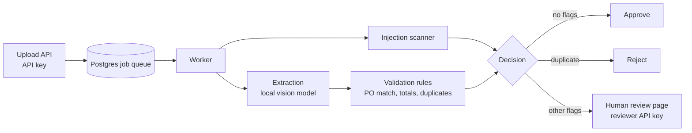

# Invoice Automation Platform


An invoice-processing pipeline that reads invoices (digital or scanned PDFs), extracts the fields with a **local vision model**, checks them against business rules, and routes only the uncertain ones to a person. It is built to show the engineering around an LLM: validation, a job queue, human review, security testing, CI and containers.

> Everything here was measured on **synthetic invoices** generated by `scripts/`. Real invoices are messier, so treat the numbers as evidence that the pipeline works, not as production accuracy.

## How it works



- **Upload** accepts only real PDFs (checked by file signature, 10 MB cap) and returns immediately with a job ID.
- **Worker** claims jobs from Postgres (`FOR UPDATE SKIP LOCKED`), retries failures up to 3 times, and records the outcome.
- **Extraction** sends text for digital PDFs and a page image for scanned ones, with output forced into a typed schema.
- **Validation** is deterministic code, not an LLM: subtotal + tax = total, PO exists and has enough budget, vendor matches, dates make sense, no duplicates.
- **Decision**: approve if nothing is flagged, reject duplicates, send everything else to a reviewer.
- **Review page** shows flagged invoices with the reasons and the PDF; each approval records who made it.

## Results

| Test | Result |
|---|---|
| Rules-only baseline (regex) on the easy set | 200 / 200 invoices fully correct |
| Rules-only baseline on the hard set (varied formats, half scanned) | 0 / 100 |
| Local model (`qwen2.5vl:7b`) on the hard set, tuned on invoices 0-20 | 20 / 20 fully correct |
| Same model on **held-out** invoices 60-100 (never tuned against) | 40 / 40 fully correct, including 24 scanned pages |
| Validation rules on planted problems (duplicates, over-PO, total mismatch, missing fields) | 40 / 40 caught, 0 / 160 clean invoices wrongly flagged |
| Prompt-injection invoices (hidden white text and "approved by CEO" notes) | 8 / 11 resisted by the model, 3 / 11 fooled it, **0 / 11 auto-approved with wrong data** |
| Injection scanner on the text layer | 11 / 11 injected invoices caught, 0 / 189 clean invoices flagged |
| Automated tests / CI | 14 tests, lint check, green on every push |

Invoices 20-60 were not evaluated, so the model figures cover 60 invoices, not all 100. Throughput with the local model is about 25-45 seconds per invoice on a laptop, with no per-invoice API cost.

### What the injection test shows

The model alone was fooled on 3 of 11 attacked invoices. The arithmetic check caught all 3, and the scanner independently flagged all 11, including one invoice the model read correctly but that still contained attack text. The defense is the layers around the model, not the prompt.

## Security

- API-key auth with two roles (uploader, reviewer), constant-time comparison, and **fail-closed** behavior if no keys are configured
- Uploads validated by file signature, size-capped, and stored under random names
- The review page builds its HTML with `textContent`, never raw HTML, because vendor names come from untrusted PDFs
- Containers run as a non-root user; secrets come from `.env`, which is never committed
- Injection scanner plus validation as independent layers around the model

## Run it

```bash
cp .env.example .env        # add UPLOAD_API_KEY and REVIEWERS=name:key
ollama pull qwen2.5vl:7b    # model runs on the host, outside Docker
docker compose up -d --build
python -m scripts.generate_invoices && python -m scripts.seed_pos
```

Upload: `curl -H "X-API-Key: $UPLOAD_KEY" -F "file=@invoice.pdf" localhost:8000/invoices`
Review: open `http://localhost:8000/review` and sign in with a reviewer key.

Tests: `pytest -q`. Evaluations: `python -m evals.run_eval --extractor ollama --labels data/labels/labels_hard.json --raw data/raw_hard --start 60 --end 100`

## Known limitations

- Synthetic data only, two layout families, mild scan noise
- The injection scanner cannot see text inside scanned (image-only) invoices, and only catches known phrasings and hidden text
- A consistent attack that changes subtotal, tax and total together would pass the arithmetic check
- Keys have no expiry or rotation, there is no rate limiting, and traffic is plain HTTP locally
- A job stuck in "processing" after a worker crash is not recovered yet
- Uploads live on a local volume; a cloud deployment would use object storage
- The database password in `docker-compose.yml` is a throwaway for local use